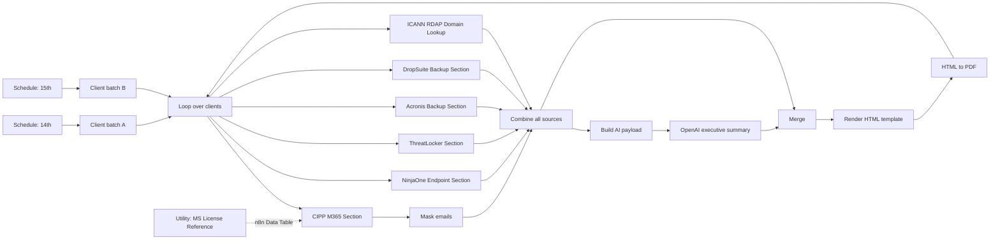

# Monthly Client Security Audit Report (n8n)

An n8n automation that builds a branded, client-ready **monthly security audit PDF** for every managed client of an MSP. It pulls data from Microsoft 365 (via CIPP), NinjaOne, ThreatLocker, Acronis, DropSuite, and public RDAP. It then writes an AI executive summary and renders everything into a multi-page PDF.

> All client names, domains, tenant IDs, credential IDs, and internal URLs have been replaced with placeholders. The sample clients are Contoso Ltd, Fabrikam Inc, and Northwind Traders.

## What the report covers

| Area | Source | Highlights |
|---|---|---|
| Identity & licensing | CIPP (Microsoft Graph) | Licensed users, MFA coverage, unlicensed-but-enabled accounts, admin role assignments, license SKU names |
| Microsoft Secure Score | CIPP (Graph `secureScores`) | Tenant score vs. peer benchmark |
| Intune devices | CIPP (Graph `managedDevices`) | Compliance and Defender state. Skipped automatically when the tenant has no Intune-capable SKU. |
| Email & storage | CIPP | Quarantine stats, SharePoint quota usage |
| Endpoints | NinjaOne | AV coverage, definition status, OS breakdown, legacy OS, missing patches, critical/high vulnerabilities, active alerts |
| Application control | ThreatLocker | Active / offline / inactive agents |
| Backup | Acronis, DropSuite | Protected workloads, backup and DR storage, M365 backup seats |
| Domain | RDAP (rdap.org) | Domain registration expiry date |

## Architecture

Each section subworkflow takes a `Client Name` and resolves it to that platform's identifier (tenant domain, org ID, or tenant GUID). It then returns one normalized summary object. The main workflow doesn't depend on any vendor's response shape.

## Workflows

| File | Purpose |
|---|---|
| [`main-workflow/build-monthly-audit-report.json`](main-workflow/build-monthly-audit-report.json) | Main orchestrator: client fan-out, subworkflow calls, AI summary, HTML/PDF rendering |
| [`sub-workflows/cipp-m365-section.json`](sub-workflows/cipp-m365-section.json) | Microsoft 365 identity, MFA, licensing, admins, Secure Score, Intune, mail, SharePoint |
| [`sub-workflows/ninjaone-endpoint-section.json`](sub-workflows/ninjaone-endpoint-section.json) | Device inventory, AV, OS, patches, vulnerabilities, and an automated-alerts subsection |
| [`sub-workflows/threatlocker-section.json`](sub-workflows/threatlocker-section.json) | ThreatLocker agent status (fuzzy org-name matching) |
| [`sub-workflows/acronis-backup-section.json`](sub-workflows/acronis-backup-section.json) | Acronis per-workload usage |
| [`sub-workflows/dropsuite-backup-section.json`](sub-workflows/dropsuite-backup-section.json) | DropSuite M365 backup seats and storage |
| [`sub-workflows/icann-rdap-domain-lookup.json`](sub-workflows/icann-rdap-domain-lookup.json) | Domain expiry via RDAP |
| [`utility-workflow/utility-ms-license-reference.json`](utility-workflow/utility-ms-license-reference.json) | Run manually. Loads Microsoft's official SKU/product-name CSV into an n8n Data Table (`ms_license_reference`), so reports show "Microsoft 365 Business Premium" instead of a GUID. |

## Design notes

- **Normalization at the edges.** Every vendor section collapses its API responses into one summary item. Merge logic downstream is simple and source-agnostic.
- **Staggered Executions for Low-Cost API Calls.** The monthly schedule is set to run one group on the 14th and a second group on the 15th. The free CustomJS API allows ~20 calls per-day. Upgraded plan can be increased to support quantities greater than ~40 reports in a 2-day period. 
- **Lean AI payload.** The "Build AI payload" step ranks findings into `attentionItems` (high / medium / low) and caps long lists before the LLM sees anything. That keeps token use low and the output consistent. The system prompt enforces a fixed 3-paragraph structure and requires every claim to have a supporting figure.
- **PII masking.** User emails are partially masked (`jo***oe@contoso.com`) before data leaves the CIPP section.
- **Bilingual output.** The HTML template supports multiple languages.
- **Graceful gaps.** Clients without a given product (no Acronis tenant, no Intune license) get a "not applicable" result instead of a failed run.

## Setup

1. **Import** every JSON file from `main-workflow/`, `sub-workflows/`, and `utility-workflow/` into n8n.
2. **Create credentials** and attach them to the HTTP nodes:

   | Credential | Type | Used by |
   |---|---|---|
   | CIPP OAuth2 | OAuth2 API | CIPP section |
   | NinjaOne OAuth2 | OAuth2 API | NinjaOne section |
   | ThreatLocker API Header | Header Auth | ThreatLocker section |
   | Acronis OAuth2 | OAuth2 API | Acronis section |
   | DropSuite API Headers | Multiple Headers Auth | DropSuite section |
   | OpenAI | OpenAI API | AI summary |
   | CustomJS | CustomJS API | HTML to PDF ([community node](https://www.npmjs.com/package/@custom-js/n8n-nodes-pdf-toolkit-v2)) |

3. **Replace placeholders:**

   | Placeholder | Where |
   |---|---|
   | `REPLACE_WITH_CREDENTIAL_ID` | Every credentialed node (selecting the credential in the UI fixes this) |
   | `REPLACE_WITH_<SECTION>_WORKFLOW_ID` | Execute Workflow nodes in the main workflow |
   | `YOUR-CIPP-INSTANCE` | CIPP section HTTP nodes |
   | `YOUR_ACRONIS_PARTNER_TENANT_ID` | Acronis "Get Tenant IDs" helper node |
   | `us2.ninjarmm.com` | NinjaOne nodes, if your instance is in another region |
   | `BRANDING` object | "Convert Json to HTML Template" node (company name, logo, colors) |

4. **Populate the client maps.** Each one is keyed by the same client name:
   - Main workflow: `CLIENTS` arrays (one per schedule batch)
   - CIPP: `companyDomainMapping` (client to M365 tenant domain)
   - NinjaOne: `organizations` (client to org ID; run "List NinjaOne Organizations" to get the IDs)
   - ThreatLocker: `standardizedNames`
   - Acronis: `CLIENT_TENANT_MAP`
   - RDAP: `companyDomainMapping` (client to public domain)
   - DropSuite matches on organization name automatically
5. **Run the utility workflow once** to create the `ms_license_reference` Data Table.
6. Run the main workflow manually for a single test client, then enable the schedule triggers.

## Tech

n8n (Code, HTTP Request, Execute Workflow, Data Table, LangChain Agent nodes) · JavaScript · Microsoft Graph via CIPP · NinjaOne API · ThreatLocker Portal API · Acronis Cyber Protect Cloud API · DropSuite API · RDAP · OpenAI · CustomJS
