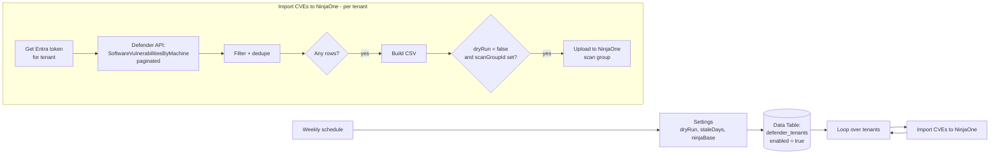

# Defender for Business CVEs to NinjaOne (n8n)

An n8n automation that pulls software vulnerabilities from **Microsoft Defender for Business / Defender for Endpoint** in each client tenant and uploads them to **NinjaOne's vulnerability management** through its scan-group CSV import. Vulnerabilities from both platforms then show up in one place, in NinjaOne.

NinjaOne already reports CVEs for the operating system and the common apps it patches. This workflow fills the gap with CVEs only Defender sees. It imports only **actionable** CVEs: ones with a fix available **and** a known exploit. Anything that would duplicate NinjaOne's findings is filtered out.

> Sanitized export. Credential IDs, the Data Table ID, and workflow IDs are placeholders.

## How it works

### Per-tenant steps

1. **Authenticate.** Requests a client-credentials token from `login.microsoftonline.com/{tenantId}` with the scope `https://api.securitycenter.microsoft.com/.default`. One multi-tenant app registration serves every client tenant.
2. **Pull vulnerabilities.** Calls `GET /api/machines/SoftwareVulnerabilitiesByMachine`, following `@odata.nextLink` until every page is in. This export returns one row per device, software and CVE.
3. **Filter.** Each row goes through the checks below in order. The first match drops the row.

   | # | Rule | Why |
   |---|---|---|
   | 1 | **Excluded software:** Microsoft `windows*`, Microsoft `edge*`, Google Chrome, Mozilla Firefox, Microsoft Defender antimalware platform | NinjaOne already patches and reports these. Importing them again would only duplicate findings. |
   | 2 | **Stale device:** `lastSeenTimestamp` older than `staleDays` (default 14) | Keeps retired or long-offline machines out of the queue |
   | 3 | **No fix available:** `securityUpdateAvailable === false` | Only imports CVEs a tech can actually fix. Rows where Defender doesn't report the field are kept. |
   | 4 | **No known exploit:** `exploitabilityLevel` is `NoExploit` or empty | Only imports CVEs that attackers can actually use: `ExploitIsPublic`, `ExploitIsVerified` or `ExploitIsInKit`. Theoretical CVEs stay out of the tech queue. |
   | 5 | **Duplicate:** same `HOSTNAME + CVE` already seen | The export can list the same CVE more than once per device (for example, several installed versions). One row per device and CVE is enough. |

4. **Normalize hostnames.** Defender often reports the full domain name (`pc01.contoso.local`). NinjaOne matches devices by short hostname, so names are cut at the first dot and uppercased (`PC01`).
5. **Build the CSV.** One row per device and CVE, with these columns: `hostname`, `cveId`, `cveid`, `software` (`vendor/name`), `version`, `severity`, `cvss`, `recommendedUpdate`, `exploitability`. The CVE ID appears in two spellings (`cveId` and `cveid`) so it lines up with whichever column name the NinjaOne scan group expects. The file is named `defender-{tenant}-{yyyy-MM-dd}.csv`.
6. **Upload.** Posts the file to `POST {ninjaBase}/v2/vulnerability/scan-groups/{scanGroupId}/upload`. The upload is skipped when `dryRun` is true or the tenant has no `scanGroupId`, so the CSV can be checked first.

Each run produces filter stats per tenant: `total`, `excluded`, `staleDevice`, `noFix`, `noExploit`, `duplicate`, `kept`. Use them to tune the exclusions.

### Error handling

A failed token request, Defender API call, or NinjaOne upload sends that tenant to a no-op `End` node, and the loop moves on to the next tenant. A single bad tenant won't stop the run. The downside is that failures are silent: nothing alerts on them. Check the execution log, or add an error notification on the `End` paths.

## What it does **not** filter on

- **Severity.** Any CVE with a fix and a known exploit is imported, whatever its severity. A critical CVE with no known exploit is held back until an exploit appears. To always import critical CVEs, change rule 4 to let `vulnerabilitySeverityLevel === 'Critical'` through.
- **Other apps NinjaOne patches** (for example, Adobe). Only the apps listed in rule 1 are excluded. If NinjaOne also reports CVEs for other apps, add them to `isExcluded` in the **Filter** node, or the same CVE will show up from both sources.

## Workflows

| File | Purpose |
|---|---|
| [`main-workflow/pull-tenants-and-scan-groups.json`](main-workflow/pull-tenants-and-scan-groups.json) | Weekly trigger, global settings, reads enabled tenants from the Data Table, loops through them. Also has a helper node, **List NinjaOne Scan Groups**, to look up scan group IDs. |
| [`sub-workflows/import-cves-to-ninja.json`](sub-workflows/import-cves-to-ninja.json) | Per-tenant token, Defender pull, filter, CSV build, NinjaOne upload |

## Setup

1. **Entra app registration** (multi-tenant) in your partner tenant:
   - API permission: **WindowsDefenderATP → `Vulnerability.Read.All`** (application type)
   - Create a client secret
   - Admin consent is needed **in each client tenant**. Your MSP tooling (for example, a CIPP app deployment standard) may already handle this automatically. To check, look in the client tenant under **Enterprise applications** (filter: All applications) → your app → **Permissions**. App registrations only shows the app in your partner tenant.
2. **NinjaOne:** create a vulnerability scan group for each client, set up for CSV import. Run the **List NinjaOne Scan Groups** helper node to get the IDs.
3. **n8n credentials:**

   | Credential | Type | Value |
   |---|---|---|
   | Defender API App | Basic Auth | Username = app client ID, password = client secret |
   | NinjaOne OAuth2 | OAuth2 API | NinjaOne API client with vulnerability management scope |

4. **Data Table** named `defender_tenants`:

   | Column | Type | Example |
   |---|---|---|
   | `tenantName` | string | `Contoso` |
   | `tenantId` | string | Entra tenant GUID |
   | `scanGroupId` | number | `12` |
   | `enabled` | boolean | `true` |

5. **Import both workflows.** In the main workflow, point **Call Pull Defender CVEs** at the imported subworkflow (`REPLACE_WITH_IMPORT_CVES_TO_NINJAONE_WORKFLOW_ID`), then assign the credentials.
6. **Settings node:**

   | Setting | Default | Meaning |
   |---|---|---|
   | `dryRun` | `false` | `true` builds the CSVs but skips the upload |
   | `staleDays` | `14` | Drops devices not seen in this many days |
   | `ninjaBase` | `https://us2.ninjarmm.com` | Your NinjaOne region URL |

7. Run once with `dryRun = true`, check the CSV and the filter stats, then switch it off and turn on the schedule.

## Troubleshooting

> [!IMPORTANT]
> **`Unauthorized request - No active license found`** (Defender Vulnerabilities node)
>
> The tenant is licensed (for example, Business Premium), but Defender for Business has never been set up. Assigning the license does **not** turn it on. Setup starts the first time an admin opens the Defender portal.
>
> 1. Sign in to **security.microsoft.com** as a Global Admin or Security Admin in the client tenant and open **Assets → Devices**. Let workspace setup finish, which can take a few hours.
> 2. Confirm the **Microsoft Defender for Business** service plan is turned on in the license assignment.
> 3. Onboard devices (Intune, or the onboarding package deployed through your RMM).
> 4. Re-run with `dryRun = true`.
>
> Until this is fixed, set `enabled = false` on that tenant's row in `defender_tenants`.

| Symptom | Likely cause | Fix |
|---|---|---|
| Get Token fails with `AADSTS700016` | App not present in that tenant | Grant admin consent in the client tenant (your MSP tooling, or `https://login.microsoftonline.com/<CLIENT_TENANT_ID>/adminconsent?client_id=<APP_CLIENT_ID>`) |
| `403 Forbidden`, no license message | Token is missing the `Vulnerability.Read.All` role, or was issued for the wrong tenant | Decode `access_token` at [jwt.ms](https://jwt.ms). `tid` must be the client's tenant ID and `roles` must include `Vulnerability.Read.All`. Fix `tenantId` in the Data Table or grant consent again. |
| `kept: 0` on every run | Nothing passes the filter, or the `exploitabilityLevel` value names don't match | Check the `stats` output and one raw row from the Defender Vulnerabilities node |
| Upload succeeds but CVEs don't attach to devices | Hostname mismatch | Make sure NinjaOne device names match the short, uppercased Defender hostname |

**New tenant checklist:** start Defender for Business setup → onboard devices → confirm the API app has consent (Enterprise applications → Permissions) → create the NinjaOne scan group → add a row to `defender_tenants`.

## Requirements

- Microsoft Defender for Business (included in Microsoft 365 Business Premium) or Defender for Endpoint P2, with devices onboarded
- NinjaOne with vulnerability management (scan groups)
- n8n with Data Tables

## Tech

n8n (Execute Workflow, HTTP Request with pagination, Code, Data Table, Convert to File) · JavaScript · Microsoft Defender for Endpoint API · Microsoft Entra client-credentials flow · NinjaOne API v2
